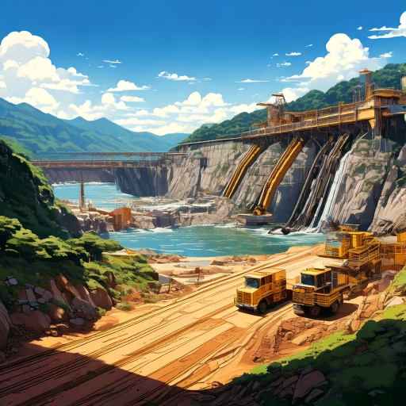

# Barragens de Mineração no Brasil

Dados das barragens de mineração, suas características técnicas, informações do tipo de rejeito armazenado, estado de conservação, dano potencial associado, classificação, localização e informações sobre a Declaração de Condição de Estabilidade obtidos a partir do Sistema Integrado de Gestão de Barragens de Mineração (SIGBM), com atualização dos dados pelo empreendedor e validação das informações em atividades de fiscalização pelos servidores da ANM.

# Passos :
- Baixar arquivo [Barragens.csv](https://dados.gov.br/dados/conjuntos-dados/barragens-de-mineracao).
- instalar bibliotecas referentes a requiments.txt
- Executaretl_barragens_de_mineracao.py.
- Ao final terá gerado na pasta etl o arquivo barragens_de_mineracao.json

**Fonte:**

**Informação atualizada em :** 

19/06/2025

**Autor:** 

Antonino Marques Jares

# Siba mais em  :
[Ativo - Área de Trampo](https://www.areadetrampo.com.br/ativo/)

